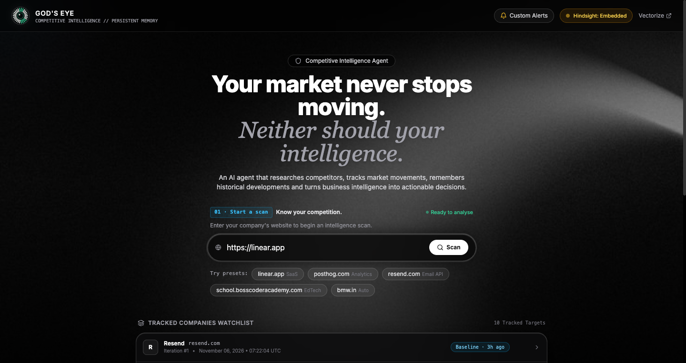
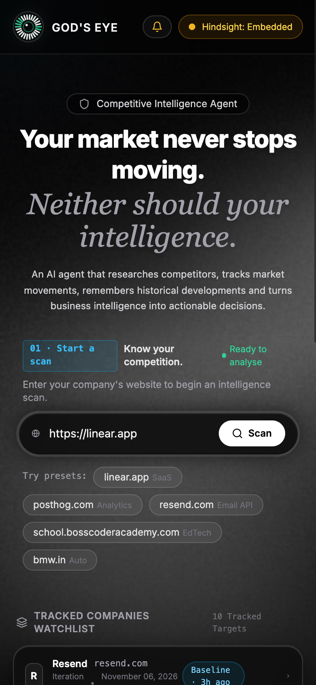
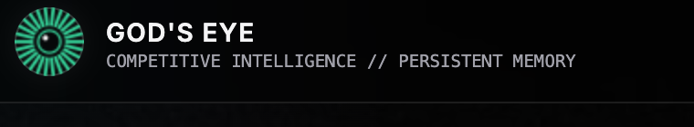

# God's Eye 👁️
### Autonomous Competitive Intelligence Agent Powered by Persistent Agent Memory

> **"Your market never stops moving. Neither should your intelligence."**
> 
> **God's Eye** is an autonomous competitive intelligence agent that researches competitors, tracks market movements, remembers historical developments, and turns raw business signals into actionable executive decisions. Powered by **[Vectorize Hindsight](https://github.com/vectorize-io/hindsight)**, Groq, and Tavily.

---

## 📸 Interface & Dashboard

| Desktop Surveillance (1440px) | 30s+ Autonomous Scanner Visualizer |
| :---: | :---: |
|  |  |

| Responsive Mobile View (390px) | Neural Memory Network |
| :---: | :---: |
|  |  |

---

## 🎯 Architecture: The Three Core Questions

God's Eye structures competitive intelligence around three foundational business questions:

1. **What happened?** — Research and monitoring
   - **Automatic Competitor Discovery**: Dynamically identifies 2–4 direct rivals across market segments for any valid target URL.
   - **Pricing & Feature Matrix**: Benchmarks tier pricing, quotas, and feature offerings side-by-side.
   - **7-Day News Pulse**: Aggregates verified announcements and news published strictly within the last 7 days.
   - **Strict Source Verification**: Every claim is tagged with `[VERIFIED FACT]` and linked to original publisher sources and URLs.

2. **Why does it matter?** — Historical analysis & trend detection
   - **Hindsight Memory Compounding**: Recalls past observations and synthesizes cross-scan trajectory via `reflect()`.
   - **Opportunity Finder**: Uncovers unaddressed market gaps competitors are ignoring.
   - **Threat Detection**: Flags aggressive rival moves with severity rankings (`High`, `Medium`, `Moderate`).
   - Tagged explicitly as `[INFERRED STRATEGY]`.

3. **What should we do?** — Strategic recommendations
   - **Actionable Counter-Measures**: Prioritized executive moves (`P0 Critical`, `P1 Offensive`) grounded in evidence.
   - **Interactive Decision Logger**: Records founder strategic decisions (Held price, Matched, Launched campaign, Ignored) and retains them into persistent Hindsight memory.
   - Tagged explicitly as `[STRATEGIC RECOMMENDATION]`.

---

## 🧠 Vectorize Hindsight Memory Primitives

Traditional RAG and web scrapers suffer from temporal amnesia: they crawl a competitor's pricing page today and forget everything tomorrow. Naive vector search mixes old and new pricing tiers together because they share identical vocabulary.

God's Eye solves this using Vectorize Hindsight's three memory operations:

- **`retain()`**:
  - Indexes verified intelligence observations, 7-day news articles with authentic publication timestamps, and founder strategic decisions.
  - Generates deterministic SHA-256 node IDs to prevent duplicate memory explosion across repeated scans.
  - Enforces domain bank isolation (`godseye-intel-{domain}`).
- **`recall()`**:
  - Pulls historical facts across prior scans using multi-strategy search (semantic similarity, keyword matching, entity graph traversal, and temporal recency).
  - Recalled memory nodes are injected directly into the LLM synthesis context.
- **`reflect()`**:
  - Synthesizes multi-temporal trajectories across stored memory nodes to evaluate long-term strategic shifts rather than isolated experiments.

### Vectorize Cloud vs. Embedded SQLite Fallback

God's Eye features a resilient dual-engine architecture:

1. **Vectorize Cloud (`api.hindsight.vectorize.io`)**: Full cloud-native memory banks with hosted vector search and native reflection endpoints.
2. **Embedded Hindsight Engine (`hindsight_embedded`)**: A zero-setup fallback utilizing local SQLite storage (`.snapshots/hindsight_embedded.db`) and Groq LLM reflection.

**Technical Integrity Policy**: In strict compliance with technical honesty, God's Eye never misrepresents local SQLite storage as Cloud Hindsight. When Cloud API credits are exhausted (HTTP 402), the system transparently reports `mode: "Embedded Fallback"`, `storage_backend: "hindsight_embedded"`, and `cloud_credits_exhausted: true`.

---

## ⚡ The 4-Stage Operational Workflow

- **`01 · Start a scan`**: Enter any company website (e.g. `https://linear.app`, `https://www.bmw.in/`, `school.bosscoderacademy.com`). Enforces strict SSRF protection (rejecting `localhost`, private subnets, and cloud metadata IPs).
- **`02 · Intelligence engine`**: 30+ seconds minimum research target with live step-by-step visual tracker and execution logs:
  1. *Understand products, positioning and market.*
  2. *Discover 2–4 relevant competitors.*
  3. *Research competitor products, pricing and features.*
  4. *Find news and articles published in the last 7 days.*
  5. *Analyse market trends, launches and Hindsight memory.*
  6. *Verify findings against original sources.*
- **`03 · Intelligence report`**: Executive competitive landscape featuring:
  - Key Statistics (`4 Competitors`, `7 days News Coverage`, `Verified Sources`, `Iteration #N`)
  - The Three Questions Bento Dashboard
  - Source Verification Drawer (view full evidence excerpts, publication dates, and URLs)
  - Custom Alerts Manager (configure alerts on price shifts and feature releases)
  - Printable / PDF Executive Report Export (`/api/export_report/{domain}`)
- **`04 · Hindsight memory`**: Visualizes the compounding relational neural network. Interrogate the memory bank with natural language queries (`/api/hindsight/ask`).

---

## 🚀 Quickstart & Installation

### 1. Prerequisites
Ensure Python 3.9+ is installed on your system:
```bash
python3 --version
```

### 2. Clone Repository & Install Dependencies
```bash
git clone https://github.com/ayushmansharma/gods-eye.git
cd gods-eye
pip install -r requirements.txt
```

### 3. Configure Environment Variables
Copy `.env.example` to `.env`:
```bash
cp .env.example .env
```

Edit `.env` with your API keys:
```env
# Vectorize Hindsight API Configuration
HINDSIGHT_BASE_URL=https://api.hindsight.vectorize.io
HINDSIGHT_API_KEY=your_vectorize_hindsight_api_key

# Groq API Configuration (for synthesis and embedded reflection)
GROQ_API_KEY=your_groq_api_key

# Tavily API Configuration (for live search and verified news pulse)
TAVILY_API_KEY=your_tavily_api_key
```
*(If you do not have Vectorize Cloud credits, the application automatically runs in Embedded Fallback mode using your Groq key.)*

### 4. Launch Application
```bash
python3 app.py
```
Or with Uvicorn directly:
```bash
python3 -m uvicorn app:app --host 0.0.0.0 --port 8000
```
Open **[http://localhost:8000](http://localhost:8000)** in your browser.

---

## 🧪 Testing Suite

God's Eye maintains both a live production audit test suite and an isolated mocked unit test suite:

### Run All Tests
```bash
python3 -m unittest discover -s tests -p "test_*.py"
```

### Run Live Production Audit Suite (20 Tests)
```bash
python3 -m unittest tests/test_audit_suite.py
```
- Tests SSRF prevention (blocking loopback, RFC1918, and metadata IPs).
- Tests arbitrary company brand extraction.
- Tests genuine historical comparisons (verifying zero manufactured price hikes on rescans).
- Tests memory persistence, company bank isolation, and secret non-exposure.

### Run Mocked Unit Suite (9 Tests)
```bash
python3 -m unittest tests/test_mocked_backend.py
```
- Tests Hindsight retain, recall, and reflect using mocked network calls.
- Tests credit exhaustion (HTTP 402) failover to embedded storage.
- Tests memory-disabled (stateless) execution.
- Tests external research provider timeouts and error handling.

---

## 📋 API Reference Summary

Detailed documentation is available in [`docs/api-reference.md`](docs/api-reference.md).

| Endpoint | Method | Description |
| :--- | :--- | :--- |
| `/` | `GET` | Frozen Glassmorphism Dashboard UI |
| `/api/scan` | `POST` | Execute or rescan target domain (`url`, `deep_mode`, `use_memory`) |
| `/api/scan_progress/{scan_id}` | `GET` | SSE real-time stage progress and execution logs |
| `/api/hindsight/status` | `GET` | Operational health and storage backend check |
| `/api/hindsight/ask` | `POST` | Direct natural language interrogation of company memory |
| `/api/watchlist` | `GET` | Tracked companies and scan iteration history |
| `/api/decisions` | `POST` / `GET` | Log and retrieve founder strategic decisions |
| `/api/alerts` | `POST` / `GET` | Configure and list competitive alerts |
| `/api/export_report/{domain}` | `GET` | Render printable / PDF executive report |

---

## 🛠️ CLI Automation Scripts

- **`scan_watchlist.py`**: Standalone batch surveillance script. Ideal for cron jobs or background monitoring.
  ```bash
  python3 scan_watchlist.py
  ```
- **`generate_intro.py`**: Offline asset compilation script used to assemble the custom Three.js wordmark sequence into `public/intro.html`.

---

## ⚠️ Known Limitations

1. **Vectorize Cloud Credits**: Active retention and reflection on `api.hindsight.vectorize.io` require positive account credits. When the balance is zero, the application seamlessly utilizes its embedded SQLite + Groq reflection engine.
2. **Third-Party Rate Limits**: High-frequency continuous scans are constrained by Tavily Search and Groq API requests per minute (RPM) limits.
3. **Paywalled Content**: Websites blocking automated scraping without public RSS or schema metadata may yield limited competitor pricing tiers.

---

## 📜 License

This project is licensed under the **MIT License** — see the [LICENSE](LICENSE) file for details.
